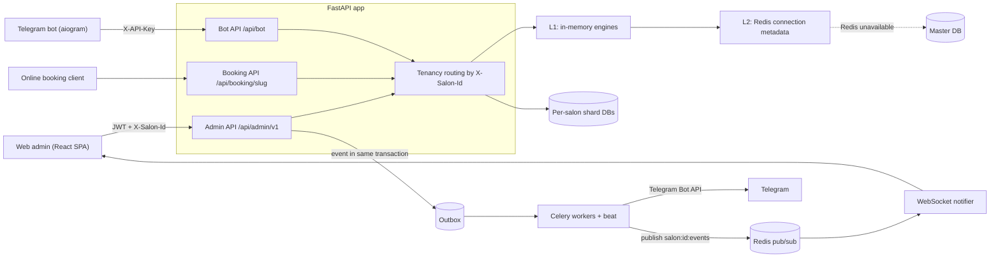

<div align="center">


**Database-per-salon tenancy, outbox-driven notifications, a Telegram bot and a React admin panel in one monorepo.**


</div>

> Note: the repository is named `adelante-crm-frontend` for historical reasons, but it holds the whole stack: backend, Telegram bot, web admin panel and deployment files.

## Pitch

Adelante CRM runs a chain of beauty salons from one installation. Each salon is a tenant with its own
PostgreSQL database; a shared Master DB holds the salon registry, administrators and network-wide loyalty
accounts. Staff manage the calendar, clients, stock and finances in a React admin panel, masters and
clients get Telegram notifications, and clients can book online through a public API.

## Highlights

- **Database-per-salon tenancy.** Requests are routed by the `X-Salon-Id` header to a per-salon shard DB through a two-level engine cache (in-memory plus Redis) with a Master DB fallback.
- **Two independent Alembic environments** (`master` and `shard`) and `salonctl`, a Typer CLI that creates salons and rolls shard migrations across all tenants, with `--dry-run` and per-salon retry.
- **Transactional outbox.** Domain events are written with the data and published by Celery; Telegram, WebSocket and loyalty side effects hang off the outbox, not off request handlers.
- **Money handled carefully.** Balances change only through one ledger service (row locks, immutable transaction journal, idempotency keys, one-time reversal); checkout totals are computed server-side and stale totals return `409`.
- **Three API surfaces**: JWT Admin API with role checks (master / administrator / superuser), API-key Bot API, public Booking API.
- **Typed frontend.** React 19 SPA with file-based routing, API types generated from the backend OpenAPI schema, and ESLint boundary rules.

## Architecture



| Component | Path | Role |
| --- | --- | --- |
| API | `backend/app` | FastAPI; Admin, Bot and Booking routers, services, SQLAlchemy models (master and shard) |
| Tenancy | `backend/app/tenancy` | Engine registry: L1 in-memory LRU, L2 Redis, Master DB fallback, pub/sub invalidation |
| Workers | `backend/workers` | Celery tasks: outbox publish, reminders, loyalty, integrity check, mail, notify |
| Notifier | `backend/ws` | WebSocket service pushing salon events from Redis pub/sub to the admin panel |
| CLI | `backend/cli.py` | `salonctl`: salons, administrators, master and shard migrations |
| Bot | `bot` | aiogram 3 Telegram bot: booking link, loyalty balance, masters' daily schedule |
| Web | `web` | React 19 admin SPA served by nginx with runtime `/config.js` |
| Deploy | `deploy`, `docker-compose*.yml` | Idempotent `bootstrap.sh`, dev and prod compose files (prod behind Traefik) |

Celery beat schedule: outbox publish every 10 s, upcoming-record scan every 60 s, nightly cashback and
certificate expiry, and a nightly integrity check that reverses dangling charges and resends lost payment events.

## Domain modules

| Module | Backend router | What it covers |
| --- | --- | --- |
| Calendar and booking | `records.py`, `calendar.py`, `booking/` | Multi-service records, optional master, slots, public online booking |
| Staff and shifts | `staff.py`, `shifts.py` | Roles, per-day shifts, vacation and sick marks |
| Clients | `clients.py` | Client cards, segments, Telegram linking by phone |
| Services | `services.py` | Services and categories |
| Finances | `finances.py`, `checkout.py` | Receipts, cash registers, payment methods, split payments, reversals |
| Inventory | `inventory.py` | Stock movements under row locks, barcodes, consumables per record, product sales |
| Loyalty and accounts | `loyalty.py`, `accounts.py` | Cards, tiers, cashback, bonus services, deposit and debt accounts |
| Gift certificates | `certificates.py` | Issue, redeem, expiry |
| Reviews | `reviews.py` | Review links after a visit |
| Audit | `audit.py` | Change log |
| Reports | `reports.py` | Revenue by day, master and service, product reports |
| Settings | `settings.py` | Salon settings and schedule |

## Tech stack

| Layer | Technologies |
| --- | --- |
| Backend | Python 3.12, FastAPI, SQLAlchemy 2 (async), asyncpg, Alembic, Pydantic 2, PyJWT, argon2 |
| Data | PostgreSQL 17 (master and shards), Redis 7 |
| Async | Celery (queues `default`, `notifications`), Redis pub/sub, websockets |
| Bot | aiogram 3, httpx |
| Frontend | React 19, Vite 8, TypeScript, Ant Design 6, TanStack Router and Query, Zustand, zod, openapi-fetch |
| Quality | pytest + testcontainers, Vitest + Testing Library, ruff, mypy, ESLint, Prettier |
| Delivery | Docker, GitHub Actions, GHCR, Traefik |

## Quick start

Prerequisites: Docker, Python 3.12+, Node 22. Commands are taken from `backend/README.md`, `web/package.json` and `docker-compose.yml`.

```bash
cp .env.example .env                       # fill in secrets
docker compose up -d postgres-master postgres-shards redis

cd backend
pip install -e .[dev]
salonctl migrate master
salonctl salon create --name "Demo" --slug demo --secret-env SALON_DEMO_DB_PASSWORD
salonctl administrator create --email admin@example.com --password "<password>" \
    --first-name Admin --salon demo --superuser
salonctl migrate shards                    # --dry-run shows the plan

uvicorn app.main:app --reload                                              # API :8000
celery -A workers.celery_app:celery worker -Q default,notifications -l info
celery -A workers.celery_app:celery beat -l info                           # exactly one instance
uvicorn ws.main:app --port 8001                                            # WebSocket notifier

cd ../web
npm ci && cp .env.example .env.local && npm run dev                        # http://localhost:5173
```

`docker compose up -d` builds the full dev stack instead (api, worker, beat, ws, bot, web on port 3000).

## Testing and CI/CD

- **Backend:** `pytest` in `backend/` (needs Docker). 23 test modules; `tests/conftest.py` starts PostgreSQL and Redis via testcontainers, applies migrations through `salonctl`, and gives each module its own salon. The worker is tested in Celery eager mode with Telegram sending stubbed.
- **Frontend:** `npm run check` in `web/` runs typecheck, ESLint, Prettier check and Vitest.
- **Workflows** (`.github/workflows`):
  - `backend-deploy.yml`: ruff, ruff format check and mypy; then build and push the image to GHCR; then deploy over SSH (`deploy/bootstrap.sh` runs migrations before services restart).
  - `frontend-deploy.yml`: `npm run check` on pull requests and pushes; on `main` it also builds, pushes and deploys the web image.
- The workflows do not run `pytest`; backend tests are run locally.

## Project structure

```text
.
├── backend/
│   ├── app/            api/{admin,booking,bot}, models/{master,shard}, services, tenancy, notifications
│   ├── workers/        Celery app and tasks (outbox, reminders, loyalty, integrity, mail, notify)
│   ├── ws/             WebSocket notifier
│   ├── migrations/     master/ and shard/ Alembic environments
│   ├── tests/          integration and unit tests
│   ├── docs/           feature specs and frontend briefs
│   └── cli.py          salonctl
├── bot/tgbot/          Telegram bot
├── web/                React 19 admin SPA (pages, widgets, shared, routes) and docs/
├── deploy/bootstrap.sh
├── docker-compose.yml / docker-compose.prod.yml
└── ui/                 legacy Next.js frontend, no longer deployed
```

## Status and notes

- Active project; `web/` is the current admin panel. `ui/` is the previous Next.js frontend kept in the tree; a comment in `docker-compose.prod.yml` states it is no longer deployed.
- There is no public `/booking` page in `web/`; the Booking API exists in the backend, and a standalone booking site is planned as a separate project.
- `TESTING_SUMMARY.md` (dated 2026-08-28, written against the old `ui/`) lists open items: switching between two real salons not verified end to end, the WebSocket flow (outbox to toast) not tested end to end, finance dashboard charts still on mock data, and the free-slots endpoint not wired to any UI component. Some may have changed since.
- Repository documentation is partly in Russian and Ukrainian; the UI is Ukrainian and times are handled in `Europe/Kyiv`.
- No license file is present; all rights reserved by default.

---

<div align="center">

Built by **Vladislav Shmalii**, Full-Cycle AI Engineer.

</div>
